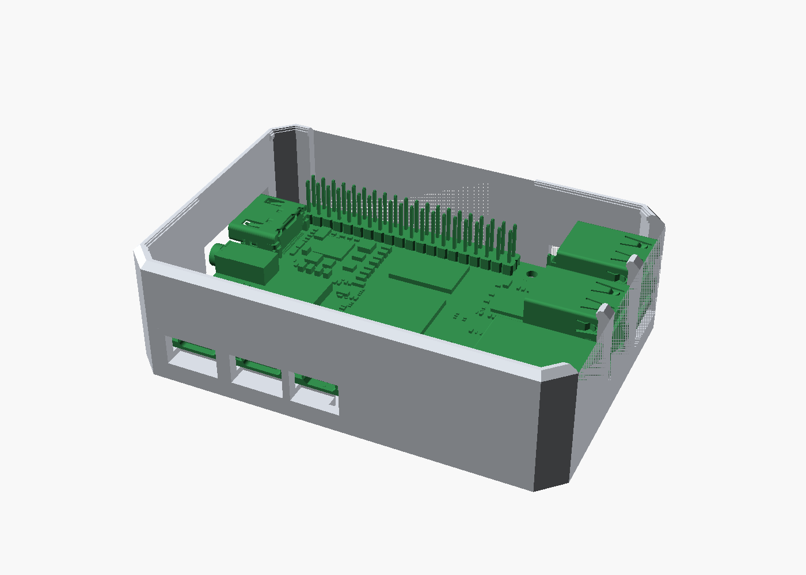
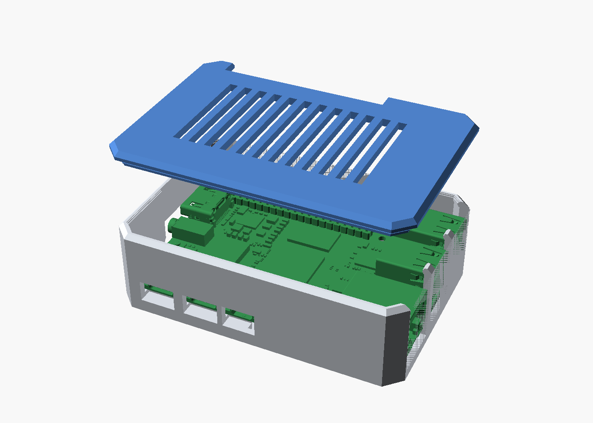
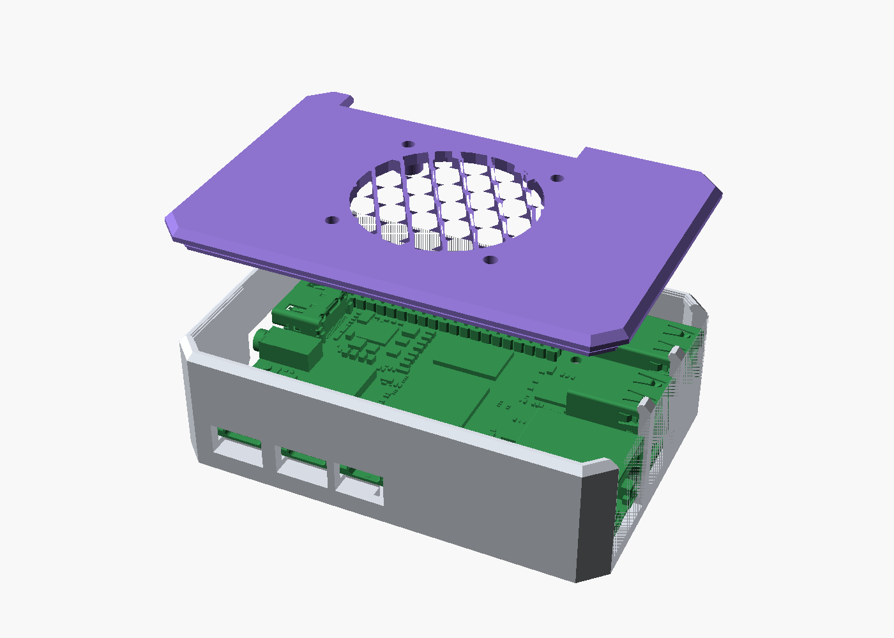
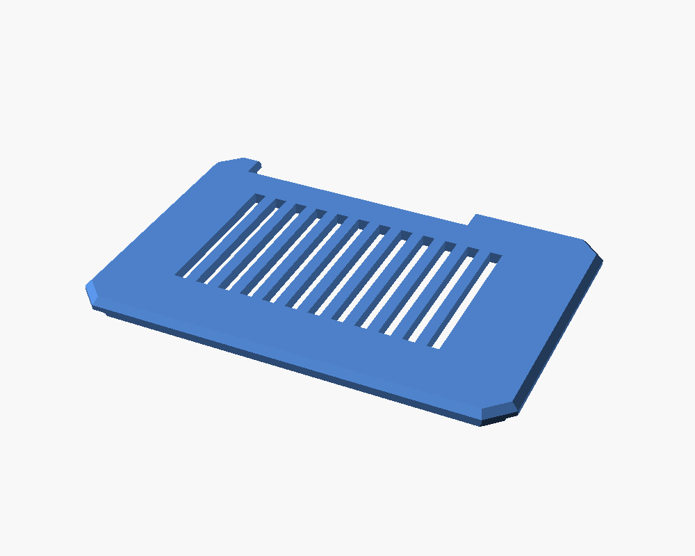
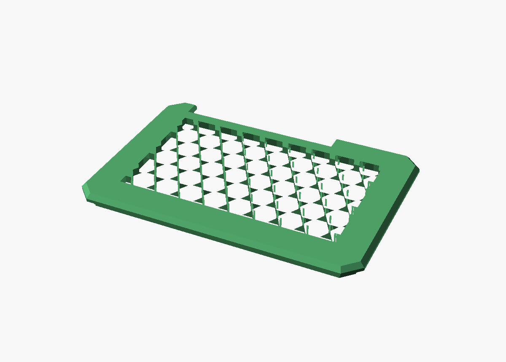
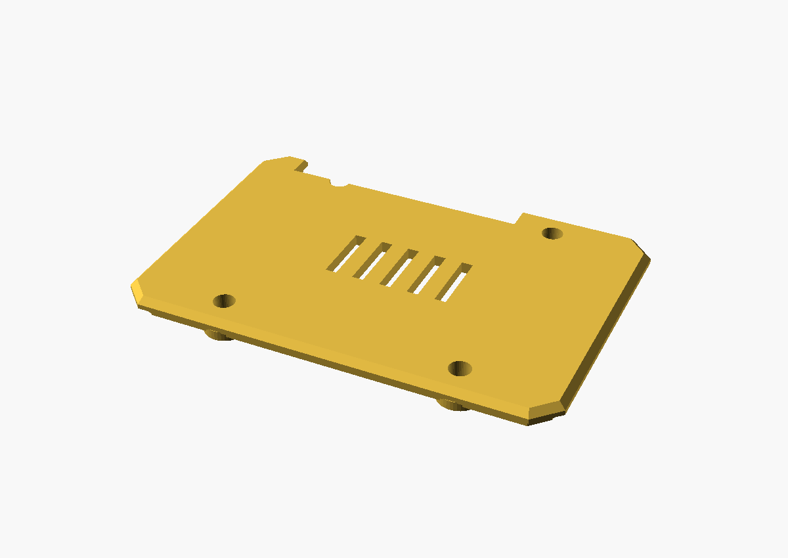
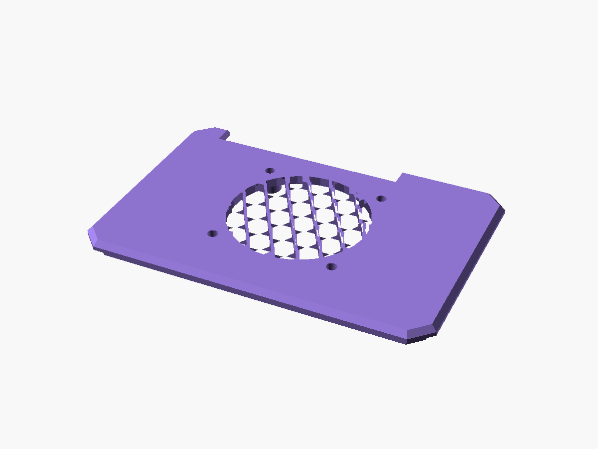
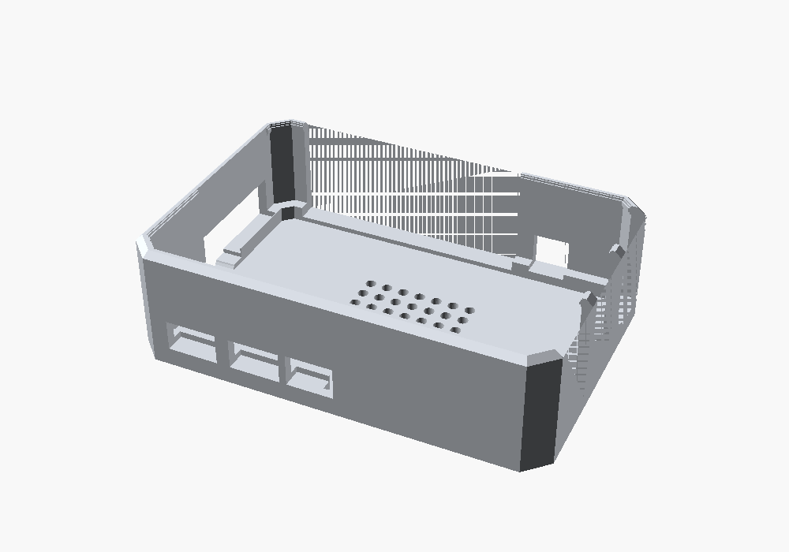

# RDK X5 Modular Case

> **The first open-source 3D-printable case for D-Robotics RDK X5 8GB.**
> Fully parametric OpenSCAD source. One base, four swappable lids.
> Licensed under **CC BY 4.0**.



<p align="center">
  
  
</p>

> Snap-on lids over a board held by an outer clamp — no PCB-side screws.

> **v5.3 (2026-11):** fixes the board not fitting in the v5.2 base. See [Changelog](#changelog) and [Putting the board in](#putting-the-board-in).

## Why this exists

As of May 2026, RDK X5 has **no community 3D-printable case** on Printables,
Thingiverse, Cults3D, or English-language MakerWorld. The official metal/acrylic
cases from Yahboom, Waveshare, and DFRobot are heavy and don't fit inside
robot bodies. This repo fills that gap with a community-first, remix-friendly
modular design.

Originally built as a byproduct of [Project Korosuke (コロ助)](https://github.com/Robostadion/corosuke-robot),
an animatronic robot competing in the **D-Robotics Robotics Dream Keeper Challenge**.

## One base, four lids

| Lid | Preview | STL | Use case |
|-----|---------|-----|----------|
| **Default** (closed, cooling slits) |  | [`lid_default.stl`](stl/lid_default.stl) | Everyday use, dust protection, mild cooling |
| **Open** (honeycomb vent) |  | [`lid_open.stl`](stl/lid_open.stl) | Maker projects, full heatsink exposure, max airflow |
| **VESA Mount** (50×50 M4) |  | [`lid_vesa.stl`](stl/lid_vesa.stl) | 50 mm 4-hole bracket mount (board is too small for full VESA-75) |
| **Fan** (40 mm fan mount) |  | [`lid_fan.stl`](stl/lid_fan.stl) | Active cooling — mount a 40 mm fan (e.g. 4010) over a honeycomb intake grille |

Common base: [`case_base.stl`](stl/case_base.stl) — works with all four lids.

### Powering the fan

The **Fan lid** takes a standard **40 × 40 × 10 mm (4010) 5 V fan**, held by
**4× M3 × 15 mm screws** on the 32 mm pattern — that length is a perfect fit
through the fan into the lid bosses. The center honeycomb doubles as a finger
guard and intake grille; the fan blows down onto the heatsink.

> ⚠️ The RDK X5's onboard fan header (**J15**) is a JST-SH **1.0 mm 2-pin** and
> is too small for most hobby-fan plugs. The simplest reliable hookup is the
> **40-pin GPIO header**: fan **+ (red) → pin 4 (5V)**, **− (black) → pin 6 (GND)**.
> This runs the fan full-speed whenever the board is powered.
>
> **Measured cooling (assembled, lid on):** idle **66 °C passive → 41 °C** with the
> 4010 fan ducted through the honeycomb — a **−25 °C** drop, plenty of headroom for
> running YOLO on the BPU.



## Putting the board in

The left HDMI/audio connectors stick out 2.3 mm past the PCB edge, more than
the 1.3 mm side gap, so the board goes in at an angle:

1. Tilt the board and slide the **left side (HDMI / audio) into its window first**.
2. Lower the **right side (USB / LAN)** — that side is open at the top.
3. Let the board rest on the ledge and **centre it left–right** (it can move up to 1.3 mm in X; front–back is located by the right-side port windows).
4. Push the lid on until it clicks.

For Bambu Studio, open [`stl/rdk_x5_case.3mf`](stl/rdk_x5_case.3mf): one plate per part, print settings included.

## Specifications

| Item | Value |
|------|-------|
| Compatible board | D-Robotics RDK X5 8GB (Part No. DROBOTICS-RDK-X5-8GB-V10) |
| Reference source | Official D-Robotics V1P0 DXF & STEP (`reference/`) |
| Case footprint | ~92 × 63 × 29.5 mm (base 27.1 mm + lid) |
| PCB retention | Outer clamp (no PCB-side screws — preserves stock heatsink holes) |
| Lid attachment | **Snap / press-fit — no screws** (tunable via `SNAP_CLEAR`) |
| Designed material | PLA / PETG (2.0 mm wall) |
| License | CC BY 4.0 |

## Build (STL from source)

Requires [OpenSCAD](https://openscad.org/) 2021.01 or newer.

```bash
# Render all parts in one go
openscad -o stl/case_base.stl   -D 'SHOW=11' rdk_x5_case.scad
openscad -o stl/lid_default.stl -D 'SHOW=12' rdk_x5_case.scad
openscad -o stl/lid_open.stl    -D 'SHOW=13' rdk_x5_case.scad
openscad -o stl/lid_vesa.stl    -D 'SHOW=14' rdk_x5_case.scad
openscad -o stl/lid_fan.stl     -D 'SHOW=25' rdk_x5_case.scad
# (SHOW=11–14,25 = print-ready, flat on Z=0. SHOW=1–4,15 = design orientation.)
```

Or run `./build_all.sh` (Linux/macOS) / `build_all.ps1` (Windows).

## Print settings (suggested starting point)

| Parameter | Value |
|-----------|-------|
| Layer height | 0.20 mm |
| Walls / Perimeters | 3 |
| Top/Bottom layers | 4 / 4 |
| Infill | 20 % (gyroid) |
| Supports | **None needed** — designed support-free |
| Brim | Optional (5 mm) for warping-prone filaments |
| Filament | PLA, PETG, or PC-blend; ABS optional |

## Customization

Open `rdk_x5_case.scad` and edit the `// PARAMETERS` block. Useful knobs:

| Variable | Default | When to change |
|----------|---------|---------------|
| `GAP` | 1.3 mm | Per-side PCB clearance. The front USB-C/UART stick out 1.28 mm past the PCB edge, so do not go below 1.3. Printers with elephant's foot may need more — or enable foot compensation in the slicer |
| `LEDGE` | 2.6 mm | Width of the ring the PCB rests on. Keep it at least `GAP` + 1.3 so the board stays supported |
| `LEDGE_RELIEF_X` | [40.5, 60.5] | Front span where the ledge is cut away for the parts under the CSI connector area |
| `SNAP_CLEAR` | 0.02 mm | Lid lip press-fit. Lower = tighter lid; negative = interference |
| `SNAP_BEAD` | 0.55 mm | Snap ridge/groove engagement depth. Raise for a firmer click, lower if the lid won't close. Left out over the front connectors and the left HDMI span |
| `TOP_CLEAR` | 20 mm | Increase if using a tall heatsink + fan |
| `WALL` | 2.2 mm | Drop to 1.6 for ABS, raise to 3.0 for TPU |
| `VESA` | 50 (50×50 M4) | Max that fits on the 56 mm-deep lid; an assert guards against overhang |

## Roadmap

- [x] Default Lid — closed + cooling slits
- [x] Open Lid — frame with X-cross ribs
- [x] VESA Mount Lid — 50×50 M4 pattern (bosses fully supported on the lid)
- [x] Fan Lid — 40 mm fan mount (32 mm M3 pattern) with honeycomb intake grille
- [x] Accurate port cutouts — every connector position extracted from the
      official STEP model and verified against the real board mesh
      (USB-A ×2, RJ45, HDMI, audio, USB-C ×2, UART debug, 40-pin GPIO, microSD, fan).
      See [connector_map.md](connector_map.md) and
      `images/board_fit_verification.png`.
- [ ] Camera Lid — MIPI CSI cable pass-through (planned)
- [ ] DIN-rail Lid — industrial mount (community request welcome)
- [ ] Print validation on real hardware (PLA / PETG)
- [ ] Thermal validation under load

## Changelog

### v5.3 (2026-11)
Checked against the official STEP model, with the board mesh placed in the base:
- **Board did not sit down.** Parts hang up to 1.9 mm below the PCB along the front edge at X 42–59 and rested on the ledge. The ledge is now cut away over X 40.5–60.5.
- **Board could not be lowered in.** `GAP` 1.0 → 1.3 mm, `LEDGE` 2.0 → 2.6 mm, and no snap ridge over the front connector span and the left HDMI/audio span.
- Result: zero interference with the board seated. STLs, 3MFs and preview images regenerated. Test print: the board fits (Nov 2026).

### v5.2 (2026-06)
UART opening moved to the real Micro-USB connector position.

## Disclaimer

This is an unofficial community design. Not affiliated with or endorsed by
D-Robotics. PCB outline geometry is derived from D-Robotics' publicly
released DXF/STEP mechanical drawings (`reference/`); those original CAD
files remain the property of D-Robotics and are included for design
verification only.

## License

**CC BY 4.0** — see [LICENSE](LICENSE). You may share and adapt freely,
including commercially, as long as you give credit.

## Acknowledgments

- **D-Robotics** for publishing the mechanical reference files openly.
- **Lisa Li** and the Robotics Dream Keeper Challenge team for the warm welcome.
- The Korosuke / コロ助 character from *Kiteretsu Daihyakka* — the spark
  for this entire project.
